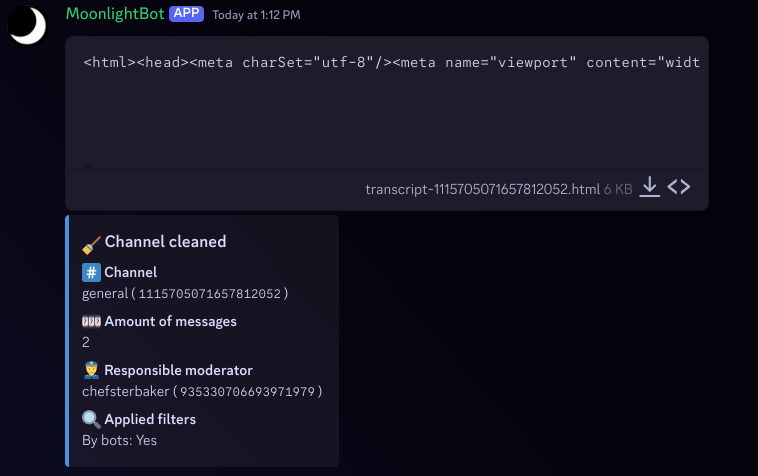

# clean

This command deletes a specified amount of messages from a channel. The command can be optionally limited by criteria, such as deleting only messages from bots, as seen in the [Options](#options) section below.


Due to limitations imposed by Discord, only messages sent within the last 14 days can be deleted.


## Required permissions

MoonlightBot requires the following permissions to successfully execute this command:

* View Channel
* Send Messages
* Manage Messages
* Read Message History

By default, a user is required to have the following permissions to use this command:

* Manage Messages

For more information on editing permission requirements for specific users/roles, refer to the [permissions tutorial](/start-up/permission-tutorial.md)

## Syntax

```text
/clean [amount] [user] [before] [after] [starts-with] [ends-with] [contains] [forwarded] [poll] [embeds] [attachments] [bots] [system] [voice] [with-thread] [stickers] [preserve-pins] [no-trace]
```

### Options

* `amount`: The amount of messages you want to clean (The default/maximum amount is 100)
* `user`: Delete messages sent by a specified user
* `before`: Delete messages sent before a specified date, a timestamp (ex. 3 days), or a linked message
* `after`: Delete messages sent after a specified date, a timestamp (ex. 3 days), or a linked message
* `starts-with`: Delete messages that start with this value
* `ends-with`: Delete messages that end with this value
* `contains`: Delete messages that contain this value
* `forwarded`: Whether or not to delete forwarded messages. 
    - If this option is left blank, the bot will not differentiate between forwarded and regular messages. 
    - If set to false, the bot will not delete forwarded messages.
    - if set to true, the bot will only delete forwarded messages.
* `poll`: Whether or not to delete polls. This works in the same way as the `forwarded` option
* `embeds`: Whether or not to delete messages containing embeds. This works in the same way as the `forwarded` option
* `attachments`: Whether or not to delete messages containing attachments. This works in the same way as the `forwarded` option
* `bots`: Whether or not to delete messages sent by bots. This works in the same way as the `forwarded` option
* `system`: Whether or not to delete system messages. System messages are messages sent by Discord, such as join or pin messages. This works in the same way as the `forwarded` option
* `voice`: Whether or not to delete voice messages. This works the same way as the `forwarded` option
* `with-thread`: Whether or not to delete messages with threads under them. This works in the same way as the `forwarded` option
* `stickers`: Whether or not to delete messages with stickers. This works in the same way as the `forwarded` option
* `preserve-pins`: If true, pinned messages will not be deleted
* `no-trace`: If true, the confirmation message will only be visible to you


The options `before`, `after`, `forwarded`, `poll`, `embeds`, `attachments`, `voice`, `with-thread`, and `stickers` are either brand new or have new functionality in version 4.9.0, currently available on [MoonlightBot beta](/support/beta.md).


## Logs

* `CHANNEL_CLEAN`: MoonlightBot will send a message with two things: an HTML file that contains the history of the deleted messages and an embed detailing where messages were cleaned, how many were cleaned, who cleaned them, and the filters applied




Rather than rendering them like other downloadable files, Discord displays the raw content of HTML files. To download the HTML file, click the download button at the bottom-right of the file display. Double-click the file, and your computer will open a new tab in your browser to display a visualization of the messages deleted.


For more information on setting up those logs, refer to the [log setup tutorial](/README.md#logging)
