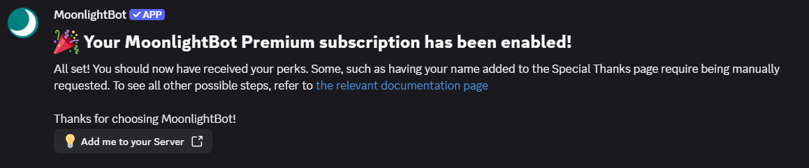
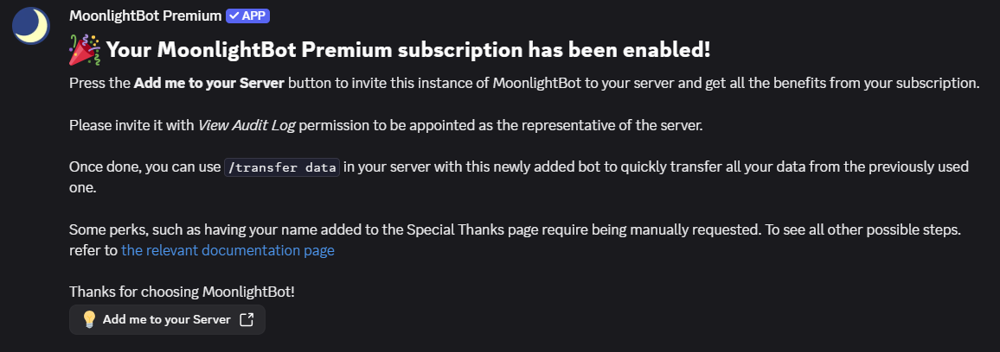
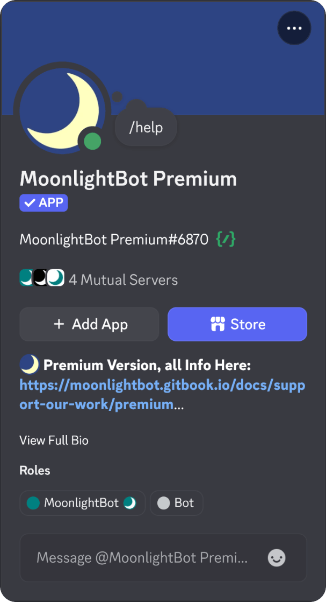

---

description: MoonlightBot Premium greatly enhances the tools at your disposal to manage your server and subscriptions help us funding hosting costs and activities.

---

# Premium Subscriptions

MoonlightBot Premium greatly enhances the tools at your disposal to manage your server.

Subscriptions help us funding hosting costs and activities, while volunteer programs make it easier and faster to continue serving an actively developed and high quality toolset by easing the pressure off the developer.

We are a non-profit, independently ran service without affiliation to large bot companies or investors.

## Tiers

| | Free | Basic | Advanced (recommended) | Super | Ultra |
| --- | --- | --- | --- | --- | --- |
| **Premium role** in the support server, with a yellow color, displayed on top, and a premium icon | ❌ | ✅ | ✅ | ✅ | ✅ |
| **Premium support channel**, with faster response times and more informational answers | ❌ | ✅ | ✅ | ✅ | ✅ |
| **Custom code evaluation** for server maintenance tasks (requires developer intervention) | ❌ | ✅ | ✅ | ✅ | ✅ |
| Your name in the **[Special Thanks Page](special-thanks.md)** | ❌ | ✅ | ✅ | ✅ | ✅ |
| **Maximum duration** for temporary actions | [7 days by default](/miscellaneous-commands/check-duration.md) | 90 days | 1 year | 1 year | 1 year |
| Temporary actions [always sustained](../start-up/faqs.md#how-does-the-temprole-sustain-mechanic-work) | ❌ | ❌ | ✅ | ✅ | ✅ |
| **Reminders** per user | 10 | 20 | 20 | 20 | 20 |
| **Reaction role groups** per server | 10 | 10 | 20 | 20 | 20 |
| **Feature requests** with higher priority | ❌ | ❌ | ✅ | ✅ | ✅ |
| **Server slots** for the MoonlightBot Premium instance | ❌ | ❌ | 1 | 3 (extra slots: $3/month each) | Unlimited |
| **Custom commands** | ❌ | ❌ | 1 | 3 (extra commands: $10 each) | 5, optionally with custom buttons, dropdowns and modals |
| | | | | | |
| **Price** | Free | $5/month | $10/month | $15/month | $30/month |
| **Other ways to obtain** | | [Voting](#upvote-moonlightbot), [Support Server Boost](#boost-the-support-server), [Volunteer as Translator](volunteering.md#translator) | [Support Server Boost](#boost-the-support-server) for 3 consecutive months, [Volunteer as Tester](volunteering.md#tester) | [Volunteer as Documentation Writer](volunteering.md#documentation-writer) | |


Basic tier benefits affect **only** your account and don't grant access to the exclusive MoonlightBot Premium bot.


## MoonlightBot Premium bot benefits

* Used in less servers, with better performance guaranteed
* Less likely to experience downtime, and faster recovery times
* Has a default maximum duration of 1 year for temporary actions
* Updates are downloaded from MoonlightBot beta, for early access to new features and improvements

## Methods to obtain Premium Subscriptions


All methods require you to be in our [Support Server](https://discord.gg/hNQWVVC). Please join before continuing.


### Subscribe on Patreon

Patreon is a platform we use to manage subscriptions. You can pledge at [https://www.patreon.com/MoonlightCapital](https://www.patreon.com/MoonlightCapital) to get started. See above for a full description of the content of each tier.

### Upvote MoonlightBot

You can upvote MoonlightBot and earn some free Premium. See the [voting tutorial](upvote-moonlightbot.md) to learn how to do that.

For your first ever vote, or for voting consecutively for 30 days, you will receive one week of Basic tier Premium. This will be prolonged as long as you continue voting at least once every 48 hours.

### Boost the support server

For [boosting the support server](https://support.discord.com/hc/en-us/articles/360028038352-Server-Boosting-FAQ-#h\_9dfb44db-c394-4339-863b-e6d1e3fb0469) you will receive your Premium subscription after having answered a few questions, a security briefing and entering an agreement.

The Premium tier for Server Boosting is initially Basic and will be upgraded to Advanced tier once you have boosted for three months consecutively.

If the server boost level is under Level 2 (less than 7 boosts) at the time you add the boost, and you can guarantee to boost the server for at least one month ahead, you will be immediately start from Advanced tier. This deal is to help keeping the Support Server at Boost Level 2 for its important perks without interruption and recover level losses.

When this occurs, an announcement will be posted and a relevant note will appear in MoonlightBot's command responses. Watch out for those so you don't miss the deal!

You will also receive the **Booster** role in the server, so everyone can see your special way of supporting us.

### Volunteer with Us

You can help us maintaining MoonlightBot by [volunteering with us](volunteering.md) and earn, among other rewards, Premium subscriptions. The corresponding tiers vary between the positions:

* **[Documentation Writer:](volunteering.md#documentation-writer)** Super, the highest tier of all volunteer positions
* **[Tester:](volunteering.md#tester)** Advanced
* **[Translator:](volunteering.md#translator)** Basic

Start by applying to any of these programs as described in the relevant sections of the page, and once you've provided significant contributions, you will be awarded your well-deserved subscriptions by the program managers!

### Giveaways and other Occasions

From time to time, we may run giveaways or other initiatives in the server to publicize Premium subscriptions. [Join the server](https://discord.gg/hNQWVVC) and watch out for the announcements we post! Psst, MoonlightBot's birthday is on May 16th.

Reporting bugs or submitting acceptable suggestions may also occasionally award temporary subscriptions. Every contribution matters!

## Managing your Premium subscription

### Activation

1. **Allow direct messages.** You will receive a direct message as soon as your subscription is activated, so set this up first. Join the [support server](https://discord.gg/hNQWVVC) if you haven't already, then open its privacy settings (from desktop: right-click the server icon; from mobile: tap the three dots at the top next to the server name and scroll down) and make sure direct messages from server members are allowed.
2. **Activate your subscription.** How you do this depends on how you obtained it:
    * **Patreon**: [connect your Discord account on Patreon's site](https://support.patreon.com/hc/en-us/articles/212052266-Getting-Discord-access), then run [`/premium enable`](/miscellaneous-commands/premium.md#enable) from anywhere. The command's page lists all the conditions that must be met. If you later change your pledge for extra server slots, run the command again.
    * **Any other method** (votes, server boosts, volunteering, giveaways): your subscription is activated as described in the relevant section above.
3. **Check the confirmation message.** It is sent by MoonlightBot or by MoonlightBot Premium, depending on your tier. If you haven't received it within 12 hours, reach out to the Staff team for assistance.

    

    

4. **Request any manual perks.** Some perks, such as having your name added to the [Special Thanks Page](special-thanks.md), are not applied automatically. To request them, contact a Staff member in the support server.

If your tier is Advanced or higher, you can now add MoonlightBot Premium to your server(s):

1. **Verify the bot is legitimate.** Click on the name of the bot that sent you the confirmation message to view its profile. MoonlightBot Premium has a verified check mark next to its username and was created on March 27, 2020.

    

2. **Add it to your server.** Use the "Add me to your Server" button in the confirmation message. Make sure you **do not uncheck** the "View Audit Log" permission, as that is required to verify it was you who added the bot and mark you as the server representative.
3. **Transfer your data.** Run MoonlightBot Premium's `/transfer data` command in your server to move your data from the main MoonlightBot. For more information, see the [FAQ](#will-i-lose-bot-configuration-and-other-data-by-switching-to-premium) below.


`/premium enable` was introduced in version 4.8.0, currently available on [MoonlightBot beta](/support/beta.md).


### Expiration

When a subscription expires gracefully, the expiration date is set to the start of the next calendar month, unless it already had an expiration date. For example, [translator](/support/volunteering.md#translator) subscriptions last 2 weeks and keep renewing while the translator meets their quota.

You will receive a DM from MoonlightBot notifying you of the expiration. The content depends on the subscription method (Patreon, votes, server boosts, a volunteer position, and so on) and the instance that sends the message depends on the tier.

### Declined payments

If your Patreon payment is declined, your subscription status will be marked accordingly.

Until the payment has been confirmed, your subscription will be suspended, which means you will temporarily lose your Premium role, and members who attempt to use commands in any server you represent will see a message inviting them to contact you and solve the issue.

You will also receive a DM about the declined payment. Its content depends on the instance that sends it.


Expiration messages and automatic suspension were introduced in version 4.8.0, currently available on [MoonlightBot beta](/support/beta.md).


## Custom commands

We can now create custom commands in your servers! They can combine parts of already existing commands, or even provide unique functionality to improve automation for your servers.

As those custom commands are tailored for your experience, they will have to be developed on the fly at your request. This may usually take up to a week for your commands to be available.


All custom features must comply with Discord's [Developer Policy](https://discord.com/developers/docs/policies-and-agreements/developer-policy) and [Developer Terms of Service](https://discord.com/developers/docs/policies-and-agreements/developer-terms-of-service).


For any question regarding custom commands, or to get started with their development, please contact a Staff member in our support server and we will be happy to assist you as best as we can.

## Premium Frequently Asked Questions

### Do I need to be the server owner to have a subscription in a server?

No, you don't need to be the server owner to have a subscription in a server. Whoever subscribes on Patreon gets the subscription and becomes the server's representative.

Anyone with the Manage Server permission can give your server MoonlightBot Premium. The representative is the team's point of contact for any technical or financial matters related to the subscription.

### Will I lose bot configuration and other data by switching to Premium?

Absolutely not! The server administrator can use the `/transfer data` command to transfer data from the free version of MoonlightBot to Premium. Transferrals are free and instant.

### If I have any temporary action still ongoing and my subscription expires, what happens?

They will be removed normally even beyond expiration date, providing the Premium bot is still in the server.

### Can I gift MoonlightBot Premium to another server?

Unfortunately, at the moment we do not support gifting subscriptions.

### Do you still offer lifetime subscriptions?

We decided to remove the lifetime subscription tier from Patreon. Lifetime subscriptions are now only offered as a token of appreciation for excellent conduct among our community, and for volunteers (and former) who helped with making MoonlightBot what it is now.

If you purchased or received a lifetime subscription in the past, it will remain available as long as you continue following [MoonlightBot's Acceptable Use Policy](/policies/acceptable-use-policy.md).

## Disclaimer

Premium subscribers are subject to the [Resource Provider Agreement](/policies/acceptable-use-policy.md#id-6-resource-provider-donation-policy) of the Acceptable Use Policy.

All perks are meant to come "within reason". We will turn down requests that cause excessive strain on our systems, personnel or come with certain caveats that may not be appropriate for our ecosystem. In doubt, consult our Staff first.

Premium perks are tied to server representatives being in the support server. This requirement is in place to have a mutual point of contact to respond to your inquiries and for us to reach out to you in case of important updates or feedback about the service. Leaving the server or getting removed for breaking rules will result in an automatic termination of your subscription. This requirement may be waived on occasion only by previous agreement.
